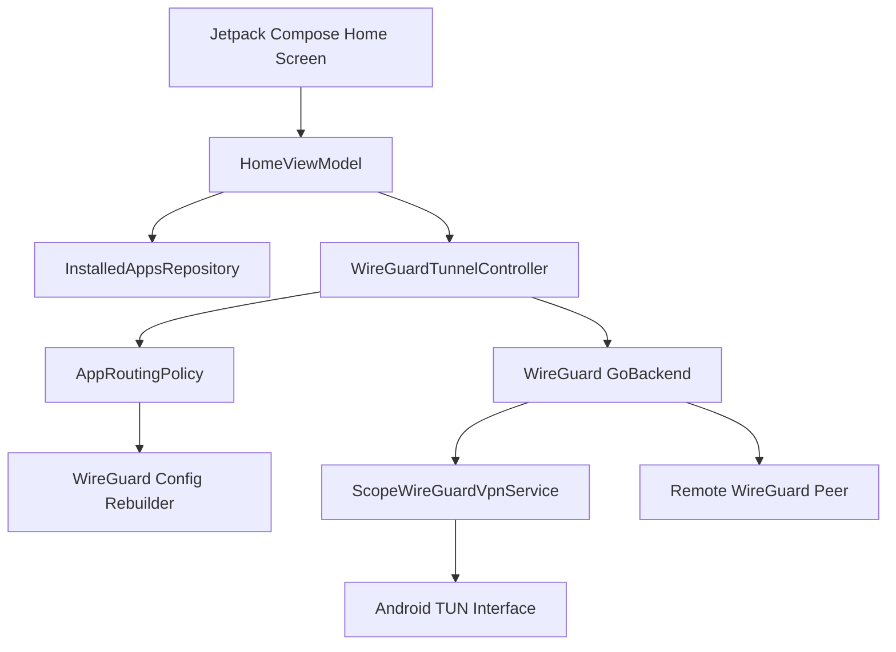

# ScopeVPN for Android

[](https://github.com/satishnada/android-vpn-implementation-guide/actions/workflows/android.yml)
[](LICENSE)

A production-minded Android VPN learning project built with Kotlin, Jetpack Compose, Android `VpnService`, and the official embeddable WireGuard tunnel library.

ScopeVPN is the complete rewrite of the original Android VPN implementation guide. The earlier sample demonstrated how to create a local TUN interface, but did not implement the packet transport and cryptography needed to carry traffic to a real VPN gateway. This version deliberately closes that gap by using WireGuard's maintained userspace backend.

> A TUN interface is only a virtual network interface. A usable VPN must also move packets between that interface and a remote gateway, protect its transport socket from the VPN loop, encrypt outgoing traffic, and decrypt incoming traffic.

## What the demo includes

- Real WireGuard tunnel activation through `com.wireguard.android:tunnel`
- Android VPN consent using `VpnService.prepare()`
- Secure Storage Access Framework import for a client `.conf` file
- Three routing modes:
  - all apps through the VPN
  - only selected apps through the VPN
  - selected apps bypass the VPN
- Searchable app selector with user/system filters
- Manual package-name entry for apps not visible through the launcher query
- Re-establishment of the tunnel when routing rules change
- Animated Jetpack Compose connection orb with broadcasting rings
- Explicit connection state machine: disconnected, connecting, connected, disconnecting, error
- Live WireGuard upload and download counters
- Ongoing foreground notification while the VPN service is active
- No `QUERY_ALL_PACKAGES` permission
- No sample private keys, embedded VPN credentials, analytics, or advertising SDKs
- Unit tests, Android lint, debug build, and GitHub Actions CI

## Important scope

This repository is a working Android WireGuard client demo, not a commercial VPN service. You still need a reachable WireGuard server and a server-issued client configuration.

A production VPN product also needs secure account provisioning, key lifecycle management, server selection, abuse controls, observability without traffic logging, privacy disclosures, backend operations, incident response, independent security review, and Google Play policy compliance.

## Architecture



The app owns the UI and routing policy. WireGuard owns protocol parsing, cryptography, socket protection, packet transfer, and userspace tunnel activation.

## Current toolchain

The project is pinned to the versions in `gradle/libs.versions.toml`:

- Android Gradle Plugin 9.1.1
- Kotlin and Compose compiler plugin 2.3.21
- Compose BOM 2026.08.00
- Compile SDK 37
- Target SDK 36
- Minimum SDK 24
- Java 17 bytecode
- WireGuard tunnel library 1.0.20260102

Review and update pinned versions before publishing a production application.

## Run the project

### 1. Open in Android Studio

Use an Android Studio version compatible with AGP 9.1.1, JDK 17, and Android SDK 37.

The generated bundle contains checksum-verified Gradle bootstrap scripts because the binary wrapper JAR is not embedded. After the first successful setup, generate and commit the canonical wrapper:

```bash
./gradlew wrapper --gradle-version 9.3.1
```

On Windows:

```powershell
.\gradlew.bat wrapper --gradle-version 9.3.1
```

### 2. Supply a real WireGuard client configuration

Generate a unique client profile on a WireGuard server you control. The app expects a standard `wg-quick` file:

```ini
[Interface]
PrivateKey = <CLIENT_PRIVATE_KEY>
Address = 10.0.0.2/32
DNS = 1.1.1.1

[Peer]
PublicKey = <SERVER_PUBLIC_KEY>
Endpoint = vpn.example.com:51820
AllowedIPs = 0.0.0.0/0, ::/0
PersistentKeepalive = 25
```

The values above are placeholders. Never commit a real private key. See `sample-config/client.conf.example`.

### 3. Import, filter, and connect

1. Tap **Import .conf** and select the client profile.
2. Open **App filter**.
3. Choose **All apps**, **Only selected apps**, or **Exclude selected apps**.
4. Tap **Connect** and approve Android's VPN consent dialog.
5. Generate traffic in a routed application and observe the live counters.

When a connected user changes the app list, ScopeVPN shows **Apply app filter and reconnect**. Android requires allowed or disallowed package lists to be supplied before `establish()`, so an existing interface cannot be edited in place.

## Per-app routing implementation

`AppRoutingPolicy` prevents the UI from representing an invalid allowlist/denylist combination. `Config.withRoutingPolicy()` copies the imported WireGuard interface and injects exactly one package list:

```kotlin
when (policy.mode) {
    RoutingMode.ALL_APPS -> Unit
    RoutingMode.ONLY_SELECTED -> interfaceBuilder.includeApplications(packages)
    RoutingMode.EXCLUDE_SELECTED -> interfaceBuilder.excludeApplications(packages)
}
```

WireGuard's `GoBackend` maps those values to Android's `addAllowedApplication()` and `addDisallowedApplication()` calls while establishing the TUN interface.

## Package visibility

Android 11 and later filter package queries. ScopeVPN declares a launcher intent inside `<queries>` and lists launchable applications only. This avoids requesting broad package inventory access.

Some packages do not expose launcher activities. The app therefore supports manual package-name entry, but Android will reject a routing entry if that package is not installed or cannot be resolved when the tunnel is established.

## Foreground VPN service

The WireGuard AAR supplies `GoBackend.VpnService`. ScopeVPN replaces that manifest entry with `ScopeWireGuardVpnService`, a subclass that posts an ongoing notification. `WireGuardBackendContext` redirects the backend's explicit service start to the subclass and then delegates all VPN behavior back to `GoBackend`.

This integration is isolated, documented, and version-pinned because it depends on the backend's current service-start behavior. Re-test it whenever the WireGuard dependency changes.

Android 14 and later require foreground service types. The demo uses `systemExempted`, which Android documents for VPN apps configured through system VPN settings. The app opts out of always-on behavior because imported configuration is intentionally kept in process memory only.

## Security decisions

- Client configuration bytes are read through the Storage Access Framework.
- The parsed configuration and private key remain in process memory only.
- Android backup and data extraction are disabled.
- Cleartext application traffic is disabled in the manifest.
- No key, configuration, or packet contents are logged.
- No private key is included in the repository.
- WireGuard implements the tunnel protocol instead of custom cryptography.
- The sample does not inspect, modify, sell, or upload user traffic.

Memory-only storage means the user must re-import the profile after process death. A production app should provision keys through an authenticated backend and protect persisted secrets with a documented key-management design. Android Keystore can protect local wrapping keys, but it does not make an exported plaintext configuration safe.

## Connection animation

`BroadcastingVpnOrb` is a pure Compose component. It renders three phase-shifted rings on a `Canvas` and fades them as the radius expands. The animation runs only while the state is `CONNECTING` or `CONNECTED`; the center button uses separate busy and resting transitions and includes accessibility semantics.

## Build and verify

```bash
./gradlew testDebugUnitTest lintDebug assembleDebug
```

CI runs the same checks for pushes and pull requests.

Useful manual tests are documented in `docs/testing.md`.

## Repository map

```text
app/src/main/java/com/satishnada/scopevpn/
|-- MainActivity.kt
|-- AppContainer.kt
|-- data/
|   |-- apps/InstalledAppsRepository.kt
|   `-- vpn/
|       |-- ScopeWireGuardVpnService.kt
|       |-- WireGuardBackendContext.kt
|       |-- WireGuardConfigExtensions.kt
|       `-- WireGuardTunnelController.kt
|-- domain/
|   |-- model/
|   `-- validation/
`-- ui/
    |-- home/
    `-- theme/
```

## Known limitations

- One imported profile and one active tunnel
- No server provisioning or server list
- No encrypted persistence of the client profile
- No automatic reconnect after process or device restart
- Always-on VPN intentionally disabled
- No kill-switch UI beyond Android's system-level VPN controls
- App icons are not loaded in the selector to keep the sample focused
- No instrumentation tests that require a live WireGuard gateway
- Device/OEM background behavior still needs physical-device testing

## Article and supporting documents

- `docs/medium-article.md` - full article draft
- `docs/article-review.md` - review of the original article and rewrite decisions
- `docs/architecture.md` - implementation details and trade-offs
- `docs/testing.md` - manual and automated test plan
- `docs/google-play-vpn-checklist.md` - release-readiness checklist
- `docs/launch-package.md` - LinkedIn, Medium, SEO, and repository launch copy
- `docs/publishing.md` - safe upgrade steps for the existing GitHub repository

## Responsible use

Use this project only with infrastructure and traffic you are authorized to access. Do not use it to intercept another person's communications, bypass access controls, conceal abusive activity, or misrepresent how user traffic is handled.

## Author

**Satish Nada**  
Mobile App Engineer and Android Architect  
LinkedIn: https://www.linkedin.com/in/satishnada/

## License

Apache License 2.0. WireGuard is a registered trademark of Jason A. Donenfeld. This repository is an independent educational project and is not endorsed by the WireGuard project.
