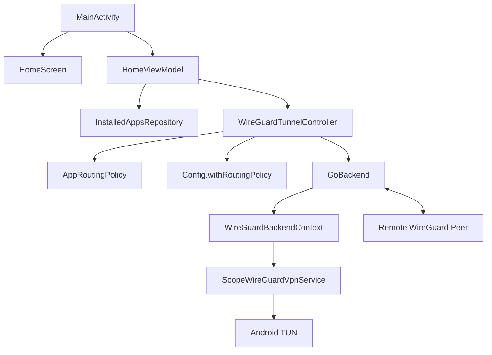
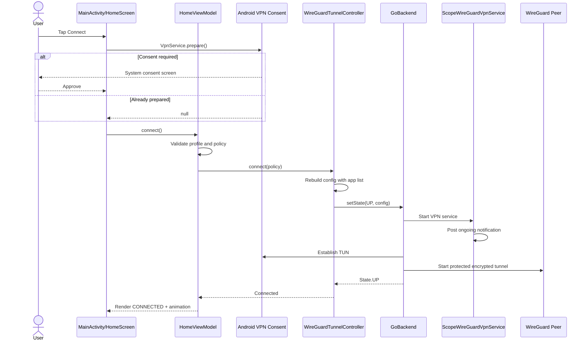
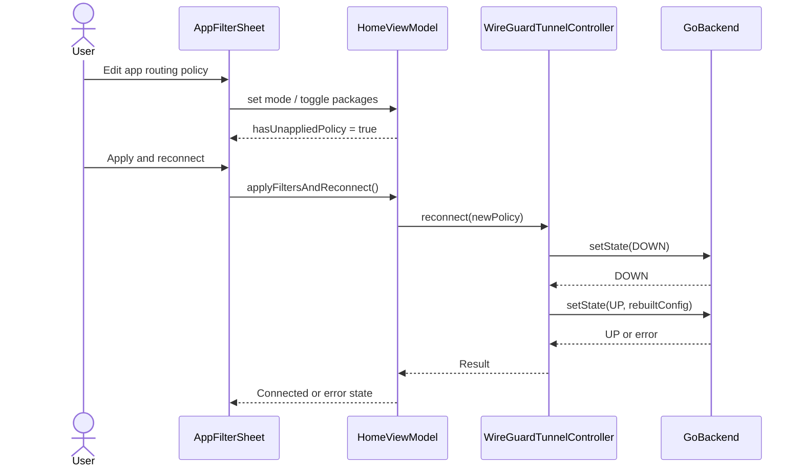
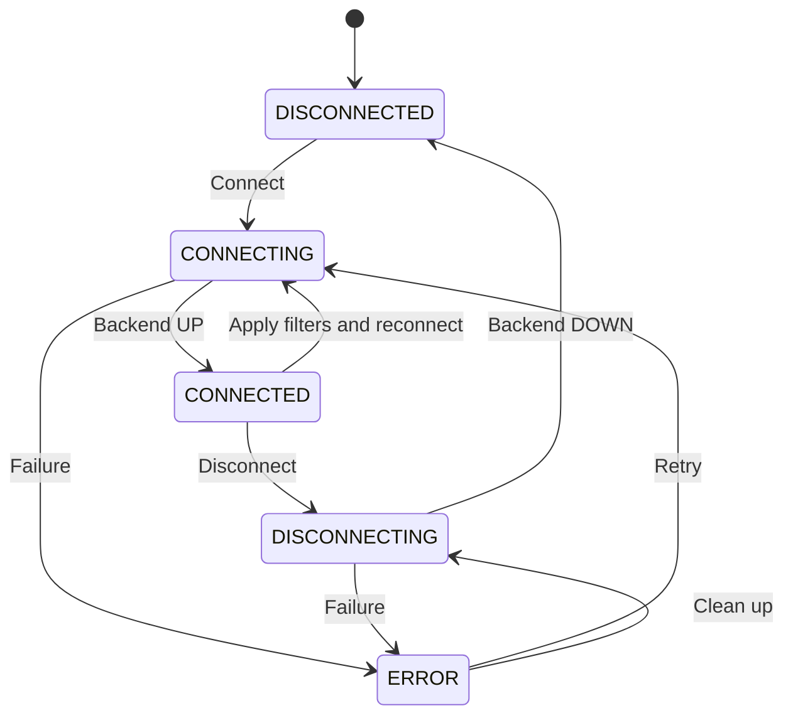

# ScopeVPN Architecture

## Purpose

ScopeVPN is a production-minded learning project, not a full commercial VPN product. Its architecture demonstrates a truthful separation between:

- Android's VPN permission and TUN interface
- WireGuard's tunnel protocol and packet engine
- app-wise routing policy
- service lifecycle and notification
- Compose presentation state

## Component view

## Layer responsibilities

### UI layer

`HomeScreen` and its supporting composables:

- render immutable `HomeUiState`
- collect user intent through callbacks
- show a connection animation driven by state
- provide app search, user/system filters, and routing-mode selection
- display unapplied filter changes
- do not create, parse, or mutate WireGuard configuration

### Presentation layer

`HomeViewModel`:

- owns the public state machine
- validates routing choices before connection
- serialises connect, disconnect, and reconnect operations with a `Mutex`
- loads the app inventory
- polls tunnel statistics only while connected
- differentiates editable policy from active policy
- maps errors to user-facing messages

### Domain layer

`AppRoutingPolicy`:

- represents one of three routing modes
- owns selected package names
- prevents an empty allowlist
- provides a human-readable summary
- contains no Android or WireGuard type

`InstalledApp`, `TunnelProfile`, `TunnelStatistics`, and `VpnConnectionState` are similarly platform-light models.

### Data and integration layer

`InstalledAppsRepository`:

- queries launcher activities allowed by package visibility
- normalises results by package name
- marks system applications
- supports a privacy-minimising app selector

`WireGuardTunnelController`:

- parses and validates imported configuration
- stores the active in-memory profile
- rebuilds the WireGuard interface with the selected routing policy
- controls `GoBackend`
- exposes state, active policy, connection time, backend version, and statistics

`WireGuardConfigExtensions`:

- creates a new immutable WireGuard configuration
- copies interface addresses, DNS, search domains, key pair, listen port, and MTU
- inserts exactly one included or excluded package list
- preserves the peer list

### Service layer

`ScopeWireGuardVpnService` subclasses `GoBackend.VpnService` and adds:

- notification-channel creation
- an ongoing foreground notification
- the applicable Android 14+ foreground-service type
- a safe route back to `MainActivity`

`WireGuardBackendContext` redirects the backend's explicit request to start its bundled service to the subclass. It is intentionally small and version-sensitive. The WireGuard dependency is pinned so this behavior can be revalidated on upgrades.

## Connect sequence

## Filter-change sequence

## State machine

The animation follows this state machine. It does not infer connection from a local toggle.

## Why manual dependency injection

The project has two long-lived dependencies and one ViewModel. `AppContainer` keeps the graph explicit without requiring readers to understand a DI framework before they can study the VPN behavior.

A production application can replace it with Hilt or another DI system. The important boundary is the same: a singleton tunnel controller must not be accidentally recreated for each composable or activity.

## App-routing rules

| Mode | Android mechanism | Result |
|---|---|---|
| All apps | No package list | All eligible app traffic enters the VPN |
| Only selected | Allowed application list | Only selected packages enter the VPN |
| Exclude selected | Disallowed application list | Selected packages bypass the VPN |

Allowed and disallowed lists are not combined. They are supplied before the TUN interface is established. An active filter change therefore requires re-establishment.

## Package visibility design

ScopeVPN intentionally avoids `QUERY_ALL_PACKAGES`.

It declares a launcher intent in `<queries>` and lists apps that expose launchable activities. This is adequate for a clear demonstration and aligns with data minimisation. A manual package-name field covers non-launcher packages when the tester knows the identifier.

Trade-off: the selector cannot promise a complete device inventory. The UI and README state this openly.

## Configuration and key boundary

The imported WireGuard configuration is:

- selected through the system document picker
- capped at a small maximum size
- parsed on an IO dispatcher
- validated for peer, endpoint, and allowed IPs
- retained in process memory only
- never written to logs or repository files

This reduces accidental secret persistence but means the sample cannot restore a connection after process death or reboot. Always-on support is disabled for that reason.

A production design should replace local file import with authenticated, device-bound provisioning and documented revocation.

## Foreground-service integration risk

The current WireGuard backend starts its nested VPN service with an explicit component. The context wrapper intercepts that specific start and redirects it to `ScopeWireGuardVpnService`, which inherits all backend behavior while adding foreground promotion.

This is a narrow integration seam, not a general Android pattern. On every WireGuard library update:

1. Inspect the backend's current service-start behavior.
2. Merge the manifest and inspect the resulting service declarations.
3. Test connection with the activity foregrounded and backgrounded.
4. Test Android 13 notification permission behavior.
5. Test Android 14+ foreground-service enforcement.
6. Confirm disconnect removes the notification.

## Concurrency

Connect, disconnect, and reconnect operations share an `operationMutex`. This prevents overlapping state transitions such as a second connect while the first backend call is active.

Statistics polling is held in one `Job` and cancelled on disconnect or error. Backend calls run away from the main thread.

A larger product may move lifecycle orchestration to a dedicated service-owned state store so process and UI lifecycles are completely independent.

## Error boundaries

Expected error groups include:

- VPN consent denied
- missing or malformed configuration
- unreachable endpoint
- invalid key material
- unresolved package in allowlist or denylist
- backend startup failure
- foreground-service restrictions
- network transition or peer timeout

The sample surfaces a message and enters `ERROR`. A product should map low-level exceptions to stable domain error codes, add safe diagnostics, and define retry policy by error type.

## Production extensions

The architecture can evolve by adding:

- a profile-provisioning repository
- encrypted local profile storage
- a service-owned connection state source
- network callback and reconnect policy
- region and peer selection
- account authentication
- server health and latency checks
- kill-switch settings
- leak-test automation
- privacy-safe observability
- instrumentation tests against disposable test infrastructure
