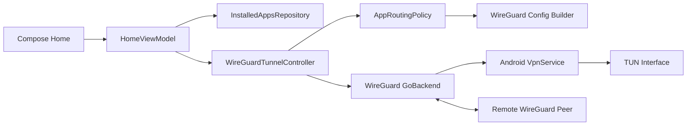

# A TUN Interface Is Not a VPN: Building a Real Per-App VPN on Android

**How to combine Android `VpnService`, WireGuard, app-wise split tunneling, a foreground service, live traffic statistics, and an animated Jetpack Compose home screen.**

A few years ago, I published a guide showing how to request Android's VPN permission and create a TUN interface with `VpnService.Builder`.

That article explained an important part of Android VPN development, but it stopped too early.

Creating a TUN interface does **not** create a complete VPN. It gives the app a virtual network interface from which it can read outgoing IP packets and to which it can write incoming packets. A real VPN client must also move those packets to a remote gateway, prevent its own tunnel socket from being routed back into the VPN, encrypt outgoing traffic, receive encrypted responses, decrypt them, and return the resulting packets to Android.

That missing packet engine is where most simplified VPN tutorials quietly end.

This article rebuilds the example from scratch and closes that gap. We will create **ScopeVPN**, an Android learning project that establishes a real WireGuard tunnel and adds a feature often requested in production VPN apps: app-wise routing.

The user can choose one of three modes:

- Route all apps through the VPN.
- Route only selected apps through the VPN.
- Route every app except selected apps through the VPN.

The home screen also visualises the connection with animated broadcasting rings, shows explicit connection states, and displays live upload and download totals.

The complete source is prepared here:

**GitHub:** `https://github.com/satishnada/android-vpn-implementation-guide`

> ScopeVPN is an educational client. It requires a WireGuard server and a unique client configuration. It is not a commercial VPN service, server platform, or privacy guarantee.

---

## What We Are Actually Building

The project has five responsibilities:

1. Ask Android for permission to become the active VPN app.
2. Import and parse a real WireGuard client configuration.
3. Apply an app-routing policy before the TUN interface is established.
4. Start and stop the WireGuard userspace tunnel.
5. Represent the tunnel state honestly in a Compose UI.

The high-level flow looks like this:



Our code owns the user experience and routing choices. WireGuard owns the protocol implementation, cryptography, socket protection, packet transport, and communication with the remote peer.

That boundary matters. Writing a VPN protocol or custom encryption layer is not a reasonable shortcut for a mobile tutorial.

---

## The Difference Between a TUN Interface and a VPN Tunnel

When `VpnService.Builder.establish()` succeeds, Android returns a `ParcelFileDescriptor`. That descriptor represents the TUN interface.

At this point, Android can direct selected app traffic into the interface. The app can read raw outgoing packets from the descriptor. But nothing automatically carries those packets to the internet.

A complete tunnel still needs a loop conceptually similar to this:

```text
Android app traffic
        |
        v
    TUN interface
        |
        v
VPN protocol engine -- encrypted transport --> remote VPN server
        ^                                          |
        |------------------------------------------|
              decrypted response packets
```

There are two especially important details:

- The transport socket connecting to the VPN gateway must be protected with `VpnService.protect()`. Otherwise, the VPN's own packets can be routed into the TUN interface and create a loop.
- The client and server need a real, authenticated encryption protocol. A raw TCP or UDP socket is not a VPN merely because its packets came from a TUN interface.

Instead of implementing those security-sensitive pieces ourselves, ScopeVPN uses WireGuard's official embeddable Android tunnel library.

---

## Why WireGuard Fits This Example

WireGuard gives the project a real packet engine without turning the article into a protocol implementation exercise.

The library's Android backend can:

- Parse a standard WireGuard configuration.
- Create and configure the Android TUN interface.
- Apply included or excluded application packages.
- Protect its transport sockets.
- Start the userspace WireGuard implementation.
- Report tunnel statistics.
- Bring the tunnel up and down.

The dependency is deliberately isolated behind `WireGuardTunnelController`. The ViewModel never talks directly to `GoBackend`, and the Compose layer never sees WireGuard-specific types.

At the time this project was prepared, the dependency was:

```kotlin
implementation("com.wireguard.android:tunnel:1.0.20260102")
```

Pin the version in a version catalog and retest the foreground-service integration whenever it changes.

---

## Step 1: Model Connection State Explicitly

A VPN is not simply connected or disconnected. Starting and stopping can take time, permission can be denied, configuration can be invalid, and the backend can fail.

Represent those states directly:

```kotlin
enum class VpnConnectionState {
    DISCONNECTED,
    CONNECTING,
    CONNECTED,
    DISCONNECTING,
    ERROR,
}
```

The home screen renders this state instead of guessing from button clicks. That prevents a common UI bug where the animation says "Connected" while the backend is still starting or has already failed.

The ViewModel exposes one immutable `HomeUiState` through `StateFlow`:

```kotlin
data class HomeUiState(
    val connectionState: VpnConnectionState = VpnConnectionState.DISCONNECTED,
    val routingPolicy: AppRoutingPolicy = AppRoutingPolicy(),
    val activePolicy: AppRoutingPolicy? = null,
    val profile: TunnelProfile? = null,
    val statistics: TunnelStatistics = TunnelStatistics(),
    val connectedAtElapsedRealtime: Long? = null,
    val installedApps: List<InstalledApp> = emptyList(),
    val message: String? = null,
)
```

Notice the difference between `routingPolicy` and `activePolicy`.

`routingPolicy` is what the user is currently editing. `activePolicy` is what was supplied when the active tunnel was established. Keeping both makes it possible to detect unapplied changes and show an **Apply app filter and reconnect** action.

---

## Step 2: Request Android VPN Consent

Only one app can own the prepared VPN interface for a user or profile. Android therefore requires explicit user consent.

```kotlin
private fun requestVpnAuthorization() {
    val intent = VpnService.prepare(this)
    if (intent == null) {
        viewModel.connect()
    } else {
        vpnPermissionLauncher.launch(intent)
    }
}
```

`VpnService.prepare()` has two possible results:

- A non-null intent means Android must show the system consent screen.
- `null` means this app is already prepared and can continue.

Do not treat the activity result as proof that the tunnel connected. It only grants permission to create the VPN interface. The ViewModel still needs to call the backend and handle the real result.

---

## Step 3: Import a Real Client Configuration

ScopeVPN uses the Storage Access Framework rather than requesting broad storage access.

```kotlin
private val configFileLauncher = registerForActivityResult(
    ActivityResultContracts.OpenDocument(),
) { uri ->
    if (uri == null) return@registerForActivityResult

    lifecycleScope.launch {
        val bytes = withContext(Dispatchers.IO) {
            contentResolver.openInputStream(uri)?.use { it.readBytes() }
                ?: error("Unable to read the selected file.")
        }
        viewModel.importConfig(bytes, queryDisplayName(uri))
    }
}
```

The controller parses the file with WireGuard's configuration parser:

```kotlin
val config = bytes.inputStream().use { input ->
    Config.parse(input)
}
```

The sample validates that the file has at least one peer, a peer endpoint, and allowed IP ranges. It also limits the imported file size.

A client profile typically looks like this:

```ini
[Interface]
PrivateKey = <CLIENT_PRIVATE_KEY>
Address = 10.0.0.2/32
DNS = 1.1.1.1

[Peer]
PublicKey = <SERVER_PUBLIC_KEY>
Endpoint = vpn.example.com:51820
AllowedIPs = 0.0.0.0/0, ::/0
PersistentKeepalive = 25
```

Never commit a real private key. Each client should receive its own profile from a server you control.

For the demo, the parsed configuration remains in process memory. Backups are disabled, packet contents are not logged, and the sample does not persist the private key. The trade-off is intentional: after process death, the user must import the profile again.

A production product needs a complete provisioning and key-lifecycle design. "Encrypt it with Android Keystore" is not a full design by itself. You still need to define who creates the key, how it is wrapped, how it is rotated, what happens on logout, whether export is possible, and what the backend revokes.

---

## Step 4: Define the App-Wise Routing Policy

Android offers two mutually exclusive ways to filter applications when a VPN interface is created:

- An allowlist: only named apps use the VPN.
- A denylist: named apps bypass the VPN.

A single connection cannot use both lists at the same time.

We can model the valid choices instead of passing loose booleans around the codebase:

```kotlin
enum class RoutingMode {
    ALL_APPS,
    ONLY_SELECTED,
    EXCLUDE_SELECTED,
}

data class AppRoutingPolicy(
    val mode: RoutingMode = RoutingMode.ALL_APPS,
    val selectedPackages: Set<String> = emptySet(),
) {
    fun validationError(): String? = when {
        mode == RoutingMode.ONLY_SELECTED && selectedPackages.isEmpty() ->
            "Select at least one app for the allowlist."
        else -> null
    }
}
```

The UX labels should explain the outcome, not expose networking vocabulary:

- **All apps**: Every eligible app uses the VPN.
- **Only selected apps**: Selected apps use the VPN; other apps connect normally.
- **Exclude selected apps**: Selected apps bypass the VPN; other apps use it.

An empty allowlist would route no application traffic, so the UI rejects it. An empty exclusion list is valid and behaves like all apps.

---

## Step 5: Add the Policy to the WireGuard Interface

WireGuard's Android configuration model lets us copy the imported interface and add exactly one application list.

```kotlin
fun Config.withRoutingPolicy(policy: AppRoutingPolicy): Config {
    val source = interfaze
    val builder = Interface.Builder()
        .setKeyPair(source.keyPair)
        .addAddresses(source.addresses)
        .addDnsServers(source.dnsServers)
        .addDnsSearchDomains(source.dnsSearchDomains)

    source.listenPort.ifPresent { builder.setListenPort(it) }
    source.mtu.ifPresent { builder.setMtu(it) }

    val packages = policy.selectedPackages.sorted()
    when (policy.mode) {
        RoutingMode.ALL_APPS -> Unit
        RoutingMode.ONLY_SELECTED -> builder.includeApplications(packages)
        RoutingMode.EXCLUDE_SELECTED -> builder.excludeApplications(packages)
    }

    return Config.Builder()
        .setInterface(builder.build())
        .addPeers(peers)
        .build()
}
```

Under the hood, the WireGuard backend maps these values to Android's `addAllowedApplication()` and `addDisallowedApplication()` methods while building the TUN interface.

There is one important lifecycle rule: the package lists must be supplied **before** `establish()`.

That means an active interface cannot be modified in place. When a connected user changes the filter, the app must bring the tunnel down and establish a new one with the updated policy.

```kotlin
suspend fun reconnect(policy: AppRoutingPolicy): Tunnel.State {
    backend.setState(tunnel, Tunnel.State.DOWN, null)
    activePolicy = null
    connectedAt = null

    return connect(policy)
}
```

The UI should tell the user this is happening. Silently restarting a VPN while displaying an unchanged "Connected" state damages trust.

---

## Step 6: Discover Apps Without Broad Package Access

On modern Android versions, package visibility filters what an app can discover. A VPN selector does not automatically need `QUERY_ALL_PACKAGES`.

ScopeVPN lists apps with launcher activities by declaring the launcher intent inside `<queries>`:

```xml
<queries>
    <intent>
        <action android:name="android.intent.action.MAIN" />
        <category android:name="android.intent.category.LAUNCHER" />
    </intent>
</queries>
```

The repository then resolves matching activities, removes duplicates by package name, and separates user and system apps for filtering.

Some valid packages do not expose a launcher activity. The UI therefore also supports manual package-name entry.

That manual field should not pretend every syntactically valid value is installed. Android validates package names when the TUN interface is established and rejects unresolved applications. The connection error must be surfaced to the user.

This is a better privacy posture than collecting a broad package inventory just to make the selector look comprehensive.

---

## Step 7: Start a Real WireGuard Tunnel

The controller owns one `GoBackend`, one `Tunnel` identity, the imported configuration, and the active routing policy.

```kotlin
suspend fun connect(policy: AppRoutingPolicy): Tunnel.State =
    withContext(Dispatchers.IO) {
        policy.validationError()?.let(::error)

        val routedConfig = requireNotNull(importedConfig) {
            "Import a WireGuard configuration first."
        }.withRoutingPolicy(policy)

        val state = backend.setState(
            tunnel,
            Tunnel.State.UP,
            routedConfig,
        )

        if (state == Tunnel.State.UP) {
            activePolicy = policy
            connectedAt = SystemClock.elapsedRealtime()
        }
        state
    }
```

This is the point where the example becomes a real VPN client rather than a TUN demonstration.

`GoBackend` establishes the interface, starts the WireGuard userspace implementation, and exchanges protected traffic with the configured peer. We do not create an empty packet loop and describe it as complete.

The controller also exposes statistics:

```kotlin
suspend fun statistics(): TunnelStatistics = withContext(Dispatchers.IO) {
    val stats = backend.getStatistics(tunnel)
    TunnelStatistics(
        receivedBytes = stats.totalRx(),
        transmittedBytes = stats.totalTx(),
    )
}
```

The ViewModel polls these values once per second while connected. That is frequent enough for a responsive demo without tying animation frames to backend calls.

---

## Step 8: Keep the VPN Service Visible

A long-running VPN should not depend on the activity remaining in the foreground.

Android requires active VPN services to present an ongoing notification. Recent Android versions also require a declared foreground-service type.

WireGuard's AAR includes `GoBackend.VpnService`. ScopeVPN replaces that manifest entry with a subclass that retains the backend implementation and adds foreground promotion:

```kotlin
class ScopeWireGuardVpnService : GoBackend.VpnService() {

    override fun onCreate() {
        super.onCreate()
        createNotificationChannel()
        promoteToForeground()
    }

    override fun onStartCommand(intent: Intent?, flags: Int, startId: Int): Int {
        promoteToForeground()
        return super.onStartCommand(intent, flags, startId)
    }
}
```

The manifest keeps the service private and protected by the VPN bind permission:

```xml
<service
    android:name=".data.vpn.ScopeWireGuardVpnService"
    android:exported="false"
    android:foregroundServiceType="systemExempted"
    android:permission="android.permission.BIND_VPN_SERVICE">

    <intent-filter>
        <action android:name="android.net.VpnService" />
    </intent-filter>

    <meta-data
        android:name="android.net.VpnService.SUPPORTS_ALWAYS_ON"
        android:value="false" />
</service>
```

This sample opts out of always-on VPN because its client configuration is intentionally kept only in process memory. Advertising always-on support while being unable to restore credentials after process death would be misleading.

The repository contains an isolated context wrapper that redirects the WireGuard backend's explicit service start to our subclass. That integration depends on the pinned backend version and must be re-tested whenever the library is upgraded.

---

## Step 9: Animate the Connection Without Faking It

The home screen's centrepiece is a Compose component called `BroadcastingVpnOrb`.

When the state is connecting or connected, three phase-shifted circles expand from the button and fade out. The effect resembles a network signal being broadcast without implying that individual packets are being visualised.

The basic animation uses one infinite transition:

```kotlin
val transition = rememberInfiniteTransition(label = "vpnBroadcast")
val progress by transition.animateFloat(
    initialValue = 0f,
    targetValue = 1f,
    animationSpec = infiniteRepeatable(
        animation = tween(durationMillis = 2_400, easing = LinearEasing),
        repeatMode = RepeatMode.Restart,
    ),
    label = "broadcastProgress",
)
```

Each ring uses a phase offset:

```kotlin
repeat(3) { index ->
    val phase = (progress + index / 3f) % 1f
    val radius = minRadius + (maxRadius - minRadius) * phase
    val alpha = (1f - phase) * 0.35f

    drawCircle(
        color = ringColor.copy(alpha = alpha),
        radius = radius,
        style = Stroke(width = strokeWidth),
    )
}
```

The animation runs only for `CONNECTING` and `CONNECTED`. It stops when disconnected, and the centre control exposes accessibility semantics independently from the decorative canvas.

A small but important product decision: animation follows the backend state, not the tap event. The moment `connect()` begins, the UI enters `CONNECTING`; only a successful `Tunnel.State.UP` changes it to `CONNECTED`.

---

## Step 10: Handle Filter Changes Honestly

While connected, the user can still open the app selector and prepare a new policy. The current tunnel continues using `activePolicy` until the user applies the change.

A computed property makes this visible:

```kotlin
val hasUnappliedPolicy: Boolean
    get() = connectionState == VpnConnectionState.CONNECTED &&
        activePolicy != null &&
        activePolicy != routingPolicy
```

When true, the home screen replaces the normal action with:

**Apply app filter and reconnect**

The reconnect action performs these transitions:

```text
CONNECTED
   -> CONNECTING (message: re-establishing with new filter)
   -> backend DOWN
   -> backend UP with rebuilt config
   -> CONNECTED or ERROR
```

This state model is easier to test than scattering booleans such as `isVpnOn`, `isLoading`, and `filtersChanged` across composables.

---

## What the App Filter Screen Includes

The bottom sheet is designed for real use rather than a static tutorial screenshot:

- Search by app label or package name.
- Switch between user apps, system apps, and all visible apps.
- Choose all-app, allowlist, or denylist routing.
- Select or clear all currently visible results.
- Add a package manually.
- Show selected count and routing summary.
- Require at least one selection for allowlist mode.
- Reconnect only when the active policy has changed.

The selected package name, not the app label, is the source of truth. Labels are not unique and can change with locale.

---

## Testing a Per-App VPN

A green connection icon is not enough evidence that split tunneling works.

Use at least two test applications and a server you control. Record the public IP address before and after connection, then verify each mode:

| Mode | Selected app | Unselected app |
|---|---|---|
| All apps | VPN public IP | VPN public IP |
| Only selected | VPN public IP | Normal public IP |
| Exclude selected | Normal public IP | VPN public IP |

Also test:

- Permission accepted and denied.
- Invalid and oversized configuration files.
- Unreachable endpoint.
- Invalid manual package name.
- Valid-looking but uninstalled package.
- App moved to background while connected.
- Screen rotation and activity recreation.
- Process termination and relaunch.
- Switching filters while traffic is active.
- IPv4 and IPv6 behavior supported by your server.
- Multiple OEM devices with aggressive background management.
- Notification permission denied on Android 13 and later.
- Android's system VPN settings and lockdown behavior.

Do not run endpoint-sensitive VPN tests only on an emulator. Physical-device networking, OEM power management, captive portals, mobile data, Wi-Fi handover, and dual-stack behavior matter.

---

## Security and Privacy Boundaries

A VPN app sits in a highly trusted position. It can route a user's network traffic, so the architecture and the product claims both need restraint.

ScopeVPN follows several deliberate rules:

- It does not inspect or upload packet contents.
- It does not include analytics or advertising SDKs.
- It does not log configurations, keys, or traffic payloads.
- It uses WireGuard instead of custom cryptography.
- It imports a configuration through the system picker.
- It disables application backup and cleartext app traffic.
- It avoids broad package visibility.
- It displays an ongoing system notification while active.
- It does not claim anonymity, invisibility, or protection from every threat.

Before publishing a VPN app on Google Play, review the current `VpnService` policy, complete the required declaration, document the core VPN functionality, encrypt traffic to the tunnel endpoint, and disclose any collection or handling of personal and sensitive data. Policy wording changes, so treat a copied checklist as a starting point rather than permanent legal advice.

---

## What a Production VPN Product Still Needs

This repository demonstrates the Android client flow. A commercial service needs much more:

- Authenticated account and device provisioning.
- Per-device key generation and revocation.
- A server fleet and regional endpoint selection.
- Secure control-plane APIs.
- Token refresh and session recovery.
- Encrypted local persistence with a documented threat model.
- Automatic reconnect and network-change handling.
- Kill-switch and lockdown behavior.
- DNS-leak and IPv6-leak testing.
- Server capacity and health monitoring.
- Abuse prevention and incident response.
- Privacy documentation and data-retention rules.
- Independent security review.
- Accessibility, localisation, support, and billing flows.

That is why a polished animation should be the last layer, not the architecture.

---

## The Most Important Lesson

Android's `VpnService` is an operating-system integration point. It is not a complete VPN protocol.

A strong implementation keeps four concepts separate:

1. **System permission**: Android allows the app to create a VPN interface.
2. **Routing policy**: Android decides which applications enter that interface.
3. **Tunnel protocol**: WireGuard securely transports packets to a remote peer.
4. **UI state**: Compose reports what the backend is actually doing.

Once those boundaries are clear, advanced features become easier to reason about. Per-app routing becomes a configuration decision. Reconnect becomes an explicit lifecycle transition. Animation becomes a truthful view of state rather than decoration pretending to be networking.

The complete ScopeVPN repository includes the Android project, app filter, connection animation, tests, CI workflow, architecture notes, Google Play checklist, and publishing material:

**GitHub:** `https://github.com/satishnada/android-vpn-implementation-guide`

I am publishing this rewrite because correcting an incomplete example is more valuable than defending it. Good technical content should evolve when the implementation can be made safer, clearer, and more honest.

Which part of Android VPN development should I cover next: secure profile provisioning, automatic reconnection, server architecture, or VPN testing?

---

## About the Author

**Satish Nada** is a Mobile App Engineer who writes about Android, mobile architecture, security, and practical design patterns.

Follow on LinkedIn: https://www.linkedin.com/in/satishnada/

---

## Official References

- Android VPN developer guide: https://developer.android.com/develop/connectivity/vpn
- Android `VpnService` API: https://developer.android.com/reference/android/net/VpnService
- Android per-app VPN guidance: https://developer.android.com/develop/connectivity/vpn#per-app
- Android package visibility: https://developer.android.com/training/package-visibility
- Android foreground-service types: https://developer.android.com/develop/background-work/services/fgs/service-types
- WireGuard Android tunnel library: https://git.zx2c4.com/wireguard-android/
- WireGuard Maven artifact: https://central.sonatype.com/artifact/com.wireguard.android/tunnel
- Google Play `VpnService` policy: https://support.google.com/googleplay/android-developer/answer/12564964
